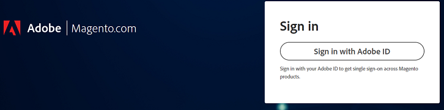

# 無法登入Adobe Commerce支援或雲端帳戶

本文提供登入Adobe Commerce支援或雲端專案有困難時的解決方案。

## 受影響的產品和版本

Adobe Commerce （所有部署方法）所有[支援的版本](https://www.adobe.com/content/dam/cc/en/legal/terms/enterprise/pdfs/Adobe-Commerce-Software-Lifecycle-Policy.pdf)

## 問題

當您前往[https://account.magento.com/customer/account/login/](https://account.magento.com/customer/account/login/)或[https://accounts.magento.cloud/user](https://accounts.magento.cloud/user)時，您可能會注意到現在已有統一的登入表單，您無法再像之前一樣輸入您的認證。

<u>要再現的步驟</u>：

請嘗試登入您的Commerce帳戶。

<u>預期結果</u>：

已成功登入。

<u>實際結果</u>：

重新導向至使用Adobe帳戶登入的頁面，但認證無法運作。

## 原因

在我們整合Adobe Commerce與其他Adobe解決方案的程式中，所有使用者都必須使用連線至其MageID的相同電子郵件地址，建立Adobe登入頁面（如果尚未建立）。

## 解決方案

您可以透過以下方式登入帳戶：

- 現有的Adobe公司/個人帳戶。
- 如果您沒有Adobe帳戶，請使用相同的電子郵件地址建立一個帳戶。

如需相關步驟，請參閱Adobe Experience League中的[Commerce Identity Manager](https://experienceleague.adobe.com/docs/commerce-admin/start/commerce-account/commerce-identity-manager.html?lang=zh-Hant)。

## 相關閱讀

- [連結Magento.com與accounts.magento.cloud帳戶登入](/help/faq/general/linking-magento-com-and-accounts-magento-cloud-account-logins.md)
